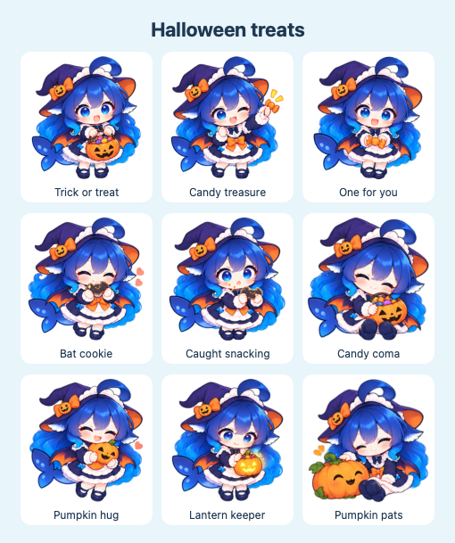

<p align="center">
  
</p>
<h1 align="center">Deepseek Chan Desktop</h1>
<p align="center">A tiny desktop companion with a big personality.<br>She keeps your coding quota close and reminds you to rest your eyes.</p>
<p align="center">
  <a href="https://github.com/furudo-erika/deepseek-chan-desktop/releases/latest">Download for macOS &amp; Windows</a> ·
  <a href="#build-from-source">Build from source</a> ·
  <a href="#roadmap">Roadmap</a>
</p>

Deepseek Chan Desktop is a fan-made desktop pet for macOS and Windows. She lives on your desktop, reacts to head pats and tiny shows, and occasionally comes over with a tiny story of her own. No AI account is needed to enjoy her company.

**Available now: macOS and Windows x64. Linux is planned.** macOS uses native SwiftUI/AppKit; the first Windows port uses Electron and shares the illustrated pose library.

<p align="center">
  
  <br><sub>A few poses from her Halloween wardrobe.</sub>
</p>

## Meet your little companion

- **279 illustrated poses across 31 collections.** Snacks, games, music, cozy naps, tiny adventures, and everyday mischief.
- **Little hellos every 2–3 minutes.** Short authored stories and playful everyday poses.
- **Coding Plan at a glance.** Codex, Claude, Grok and Cursor quota, plus DeepSeek and OpenRouter API balances. Remaining percentages, reset times, last-updated indicators and automatic refresh.
- **English controls, multilingual personality.** Small English, Chinese, and Japanese bubbles, rather than long paragraphs.
- **A Halloween wardrobe.** Witch hat, bat cape, pumpkin candy basket, a pocket ghost, 27 seasonal poses, and nine little scenes. Switch outfits whenever you like.
- **Visible eye-break reminders.** Mouse activity starts your focus timer. When it is time, she moves to the center of the active display and dances. Take a five-minute break or snooze.
- **Make her comfortable.** Drag to reposition, browse the action library, save favorites, or turn on Calm mode for gentler everyday movement.
- **Read-only usage queries.** Existing client sign-ins stay local. No model calls are needed to check quota. [Usage setup and privacy](docs/usage.md).

The artwork count means **279 distinct illustrated poses with procedural motion**, not 279 individually drawn animation clips. The app also has separate multi-frame dance/bell sequences and a three-pose Halloween reminder dance.

## Download and install

Get the DMG and its SHA-256 checksum from [Releases](https://github.com/furudo-erika/deepseek-chan-desktop/releases/latest).

| Platform | Status |
| --- | --- |
| macOS 26+, Apple Silicon | Available as an ARM64 DMG |
| macOS, Intel | No tested or published binary |
| Windows 10/11, x64 | EXE installer; first Windows release |
| Linux | Planned; no package available |

For Windows, download the EXE installer and follow the [Windows guide](docs/windows.md). For macOS:

1. Open the DMG.
2. Drag **DeepSeek-chan.app** into **Applications**.
3. Open the app from Applications. Closing its main window leaves her on your desktop; use the menu-bar menu to reopen or quit.

**Signing:** the current release is ad-hoc signed and **not notarized by Apple**. macOS may block the first launch. If you trust the download, follow [Apple’s instructions for opening an app from an unidentified developer](https://support.apple.com/en-us/102445). Do not disable Gatekeeper globally.

To verify a download, put the DMG and its `.sha256` file in the same folder and run:

```sh
shasum -a 256 -c DeepSeek-chan-1.10.1-arm64.dmg.sha256
```

## Task buddies

Connect coding agents so she reacts to their tasks: typing while they work, a wave when they need you, and a tiny celebration when a turn finishes. The new **Task buddies** panel includes setup commands for Codex, Claude Code, Cursor, Pi, OMP, Grok Build, dsh, and T3 Code.

Claude Code/Cursor/Grok use lifecycle hooks; Pi/OMP/dsh use native extensions; Codex supports MCP and a completion hook. T3 Code connects through a read-only MCP watcher. Grok uses confirmed idle rather than celebrating a vetoable stop hook. Pet feedback stays local and uses no AI API. See the [connection guide](docs/task-buddies.md) for setup and limitations.

Included in 1.9.0. Windows supports local snapshots and generic MCP; native hook installers and the automatic T3 watcher remain macOS-only. See the [Windows guide](docs/windows.md) for port differences.

## Say hello

Click her for a head pat. Right-click for **Coding Plan**, **Tiny show**, **Dance**, the action library and other interactions. Cute speech stays above her; a separate bubble below her shows remaining quota as progress bars. Click **Details** to see every quota window and connection option.

Choose **Outfit → Halloween 🎃** for her witch wardrobe. The outfit survives a restart. Playing an action card switches to that card’s outfit.

- **Little hellos** controls unsolicited stories independently of eye reminders.
- **Calm mode** reduces everyday movement and increases pauses. macOS Reduce Motion is also respected.
- **Only favorites when awake** uses favorites belonging to the current outfit. If none match, she uses that outfit’s full collection.
- **Pause** pauses eye reminders while leaving the companion available.
- **⌘0** opens the main window; **⌘L** opens the action library; **⌘W** closes the current sheet/window.

## Usage and privacy

Open **Usage / Coding Plan** to check connected providers. Codex, Claude Code, Grok Build and Cursor use local client sign-ins. DeepSeek and OpenRouter API balances accept an optional key through **Connect API balance**. API credit balances are distinct from subscription quotas.

- Refreshes every five minutes after opening Usage, with a manual refresh button and provider backoff.
- Missing or unavailable quota is shown as unavailable; it is never inferred as zero or unlimited. Old results are marked **Last known** after a failed refresh. Account changes clear previous-account values.
- Keys stay in macOS Keychain or Windows account encryption. Tokens never enter the renderer, repository or release assets. The app only sends each credential to its fixed provider endpoint.
- No conversation transcripts, account emails or personal identifiers are displayed. No provider response bodies are logged, and usage snapshots are held in memory.
- The pet's ordinary phrases and stories remain local. The previous AI chat controls are retired; no chat completion request is made by the new Usage feature.

See [all providers, supported login locations and limitations](docs/usage.md). The project has no analytics or telemetry integration.

## Build from source

Use an Apple Silicon Mac running **macOS 26 or newer**, with Apple’s Command Line Tools and the macOS 26 SDK. The app uses system frameworks; there are no Swift package dependencies and no Xcode project is required.

```sh
xcode-select --install  # If Command Line Tools are not installed yet.
git clone https://github.com/furudo-erika/deepseek-chan-desktop.git
cd deepseek-chan-desktop
zsh scripts/package-debug.sh
open dist/DeepSeek-chan.app
```

The Debug build uses `-Onone -g`. It is ad-hoc signed locally. All runtime artwork is included in the repository.

### Checks

```sh
zsh scripts/check.sh
```

This runs the timer, dialogue, drag geometry, action catalog, personality, proactive scheduling, Halloween, and task-connection checks. The connector checks require Python 3.9+ and Node.js 18+. Dialogue tests use a mock transport and require no key or paid requests. CI also builds the Debug app on macOS.

To inspect production sprite clipping visually:

```sh
swiftc -Onone -parse-as-library Sources/ActionLibrary.swift Sources/CompanionView.swift Tests/RenderActions.swift -o .build/render-actions
.build/render-actions
```

Category contact sheets are written under `.build/qa-actions-*.png`. Real multi-display dragging, full-screen behavior, sleep/wake, and long-run energy usage still need hardware testing; geometry and scheduler tests do not establish those behaviors.

### Package a release

```sh
zsh scripts/package-release.sh
zsh scripts/export-dmg.sh
# Or choose an output path:
# zsh scripts/export-dmg.sh "$HOME/Desktop/DeepSeek-chan-custom.dmg"
```

The Release build uses `-O -whole-module-optimization`. The exporter produces a compressed DMG with the app, an Applications shortcut, installation notes, and a separate checksum file. It refuses to overwrite an existing DMG. Developer ID signing and notarization are not automated yet.

The historical bundle identifier and internal executable name are retained for compatibility with existing preferences and Keychain entries.

## Project layout

| Path | Purpose |
| --- | --- |
| `Sources/main.swift` | App lifecycle, desktop panel, scheduling, and shared state |
| `Sources/Views.swift` | Dashboard, speech bubbles, chat, and AI settings |
| `Sources/CompanionView.swift` | Sprite clipping, motion, and outfit rendering |
| `Sources/PetPersonality.swift` | Authored conversations and short scene playback |
| `Sources/ProactiveChatter.swift` | Non-repeating story decks and proactive scheduling |
| `Sources/TimerEngine.swift` | Focus and eye-break state machine |
| `Sources/DialogueService.swift` | Optional OpenRouter client and Keychain storage |
| `Assets/` | Bundled illustrations, manifests, crop metadata, and generation prompts |
| `integrations/` | Local task CLI, MCP server, hooks, and Pi/OMP extensions |
| `Sources/TaskBridge.swift` | Local task snapshots, reaction queue, and task dialogue |
| `Tests/` | Focused behavior checks and artwork preview rendering |
| `scripts/` | Build, check, icon, and DMG packaging tools |

## Roadmap

- [x] Windows x64 desktop implementation and automated installer checks.
- [ ] Broader Windows hardware, DPI and feature-parity testing.
- [ ] Linux desktop implementation and testing across supported desktops.
- [ ] Developer ID signing and notarized macOS releases.
- [ ] More outfits, richer connected animations, and new local story collections.
- [ ] More hardware coverage for multiple displays, full-screen apps, and sleep/wake.

Windows uses a separate Electron implementation with shared artwork; it is not a cross-compile of the Swift app. Linux still needs platform testing and packaging. Contributions and Windows testers are welcome.

## Contributing and license

See [CONTRIBUTING.md](CONTRIBUTING.md), [CHANGELOG.md](CHANGELOG.md), and [LICENSE](LICENSE). Project code is available under the **MIT License**.

This is an independent fan project, **not affiliated with or endorsed by DeepSeek**. Illustrations were AI-generated from a fan-character direction. See [artwork provenance](Assets/ARTWORK.md) and [NOTICE](NOTICE) for asset and third-party-rights notes. External reference images are not redistributed.
